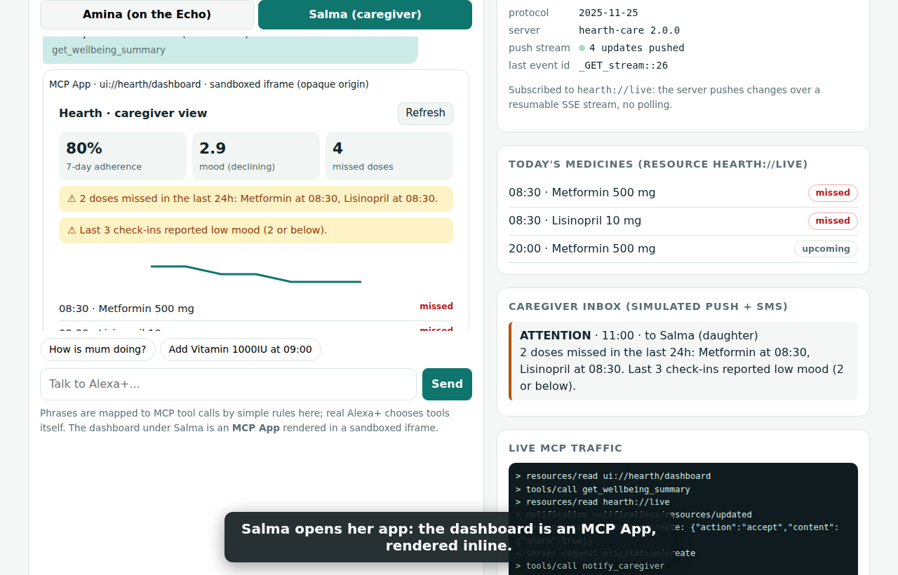

# Hearth v2: an Alexa+ care companion on MCP (Streamable HTTP + MCP Apps)

Hearth lets an older adult talk to Alexa+ about medicines and mood. Their caregiver gets a calm, honest signal only when a real pattern appears, and the person is asked before anything proactive is shared.

Track: **Alexa+** (MCP integration on Streamable HTTP + Agent Skill + web simulator).

## Run
    npm install
    npm start            # MCP endpoint http://127.0.0.1:3000/mcp   simulator http://127.0.0.1:3000
    npm test             # 24 protocol-level checks

Node 18+ (tested on Node 22). No API keys. All data is fictional and in memory.
Open the simulator at **http://127.0.0.1:3000** (the Origin allow-list covers localhost and 127.0.0.1 on the chosen port).

Demo video: `docs/demo.mp4` · Requirements and evidence: `docs/COMPLIANCE.md` · Deploy: `docs/DEPLOY.md`

## What makes it different
| Spec feature (source) | How Hearth uses it |
|---|---|
| Streamable HTTP 2025-11-25: Origin validation, localhost bind, `MCP-Session-Id`, `MCP-Protocol-Version`, 202 for notifications | Stateful sessions, 403 on foreign Origin, 400/404 per spec, bound to 127.0.0.1 |
| SSE streams, event ids, `Last-Event-ID` resumability, server-initiated messages | In-memory EventStore; subscribed clients are *pushed* `notifications/resources/updated` for `hearth://live` and can resume after a disconnect |
| MCP Apps (`ui://` resource, `_meta.ui.resourceUri`, `visibility`, postMessage JSON-RPC, theming, size-changed) | `get_wellbeing_summary` renders an interactive caregiver dashboard inline; `app_refresh` is app-only; plain text fallback for hosts without the extension |
| Elicitation | Proactive alerts need the person's consent; emergencies and explicit requests bypass it |
| Agent Skills | `skills/hearth-care/SKILL.md` defines tool use, consent policy and hard limits |
| Structured results | `structuredContent` for UI, `content` text for the model |

Personalised routine model: the "no morning activity" threshold is median + max(60 min, 4×MAD) of the person's own first-activity times (usual 07:18, alert after 08:18), not a fixed hour.

## Files
- `server.js`          MCP server (8 tools, 3 resources incl. the `ui://` view)
- `src/store.js`       care logic, personalised baseline, demo clock, change events
- `src/eventStore.js`  resumable SSE event store
- `ui/dashboard.html`  the MCP App view (no SDK, plain JSON-RPC over postMessage)
- `public/index.html`  Alexa+ simulator: real MCP client (sessions, SSE, consent) and an MCP Apps host
- `skills/hearth-care/SKILL.md`  Agent Skill
- `test.mjs`           spec-level tests (security, lifecycle, UI metadata, consent, push, resume)

## Try the demo (2 minutes)
1. As Amina: "Good morning", "I feel tired".
2. Press **+3 h**, then **★ Run proactive check**: Alexa+ asks Amina for consent (MCP elicitation) before telling Salma.
3. Switch to Salma, "How is mum doing?": the dashboard renders as an MCP App; press Refresh (app-only tool).
4. Back to Amina: "I fell" gives the emergency-first response and an urgent alert without a consent step.
Watch **Live MCP traffic** and **push stream** on the right.

## Honest limits
- Not tested on a real Alexa+ device or with third-party MCP hosts (Claude, ChatGPT, VS Code). The simulator is our own client/host; phrase-to-tool mapping is rule-based.
- The simulator's MCP Apps host uses a sandboxed `srcdoc` iframe (opaque origin) instead of the spec's recommended double-iframe sandbox proxy on a separate origin. A production host needs the proxy.
- Home signals are simulated, not connected to Ring. No auth, persistence or encryption yet. Not a medical device.
- To expose the server beyond localhost set `HOST`, `ALLOWED_ORIGINS`, `ALLOWED_HOSTS` and add authentication first.

## Roadmap
Household auth (OAuth), persistence, real Ring/IoT events, clinician-ready weekly report, Bedrock summaries (AWS mini-challenge), sandbox proxy host.
